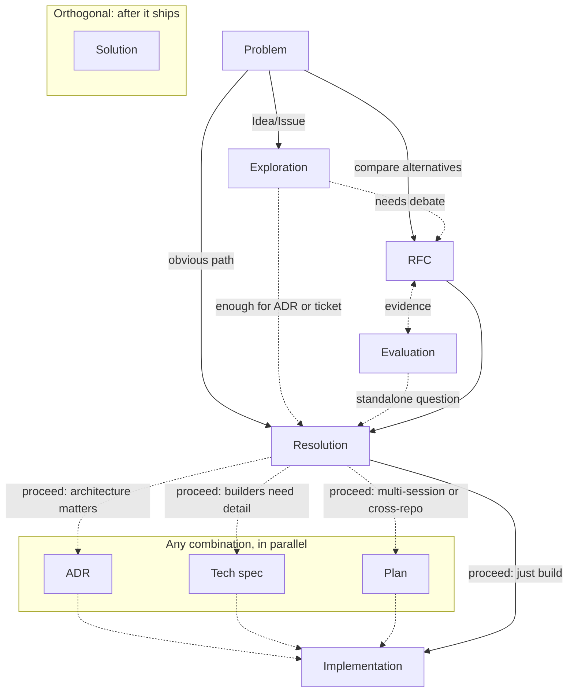

# Documentation Directory (`docs/`)

This directory contains repo documentation structured according to our standard engineering taxonomy.

---

## Suggested workflow

Use only the artifacts the work needs. They are roles, not a pipeline.

Dashed arrows are create-when conditions; the table below has Created when and Skip when. The problem is the only required node. A solid RFC-to-Resolution arrow means an RFC closes as accepted, rejected, withdrawn, or otherwise resolved. Outgoing paths apply only when the resolution proceeds. ADR, tech spec, and plan are parallel outputs: none, one, or all three. An evaluation can stand alone. Solution has no arrows: it is not a stage of the build.

| Artifact | Question | Created when | Stops changing when |
| --- | --- | --- | --- |
| Exploration | What is true in code for this idea/constraint? | The work starts from a vague idea or complex dependency and needs grounding | The idea is framed well enough for an RFC, ADR, or ticket/issue. Do not keep appending the later debate. |
| RFC | What should we do? | Meaningful alternatives exist | Resolution reached. Record an accepted direction in an ADR; keep rejected or withdrawn outcomes in the RFC. Do not append implementation, experiments, or later findings. |
| Evaluation | What does the evidence tell us? | An assumption needs dated, testable or auditable evidence | Evidence collection concludes. Link new measurements from a later evaluation or an ADR; do not rewrite the closed report. |
| ADR | What did we decide, and why? | The decision matters long-term | Accepted. Supersede rather than rewrite. Keep measurements in the evaluation. |
| Tech spec | How will we build the chosen approach? | Builders need APIs, data model, or failure modes that would make the RFC or plan too long | Implementation completes, or a later spec supersedes it. |
| Plan | How will we sequence the work? | The work is multi-session or cross-repo | Implementation completes. Mark completed or archived; use superseded only when another plan replaces it. Shipped behavior belongs in the owning repo. |
| Solution | How did we solve this recurring bug or gotcha? | After the fix ships, and a future session would otherwise rediscover it. Tracked artifact of the [compound step](https://github.com/Invoca/monarch-team/blob/main/.agents/TEAM_RULES.md#compound-step); audit drafts with [`compound-route`](https://github.com/Invoca/monarch-team/tree/main/.agents/skills/compound-route). | The writeup is validated. |
| Temp | What do I need only while working? | During active work | Delete when no longer useful. |

Do not merge `techspecs/` into `plans/`.

---

## Directory Structure

| Directory | Purpose | Retention |
|---|---|---|
| `docs/explorations/` | Technical grounding and investigations for new ideas. | Permanent (git-tracked) |
| `docs/rfcs/` | Request for Comments (RFCs) comparing technical alternatives. | Permanent (git-tracked) |
| `docs/evaluations/` | System evaluations, spike reports, and benchmark tests. | Permanent (git-tracked) |
| `docs/techspecs/` | Detailed implementation specifications and design contracts. | Permanent (git-tracked) |
| `docs/adr/` | Architecture Decision Records (ADRs) recording technical choices. | Permanent (git-tracked) |
| `docs/plans/` | Execution plans sequencing rollouts and roadmaps. | Permanent (git-tracked) |
| `docs/solutions/` | Documented solutions to recurring bugs and tooling gotchas. | Permanent (git-tracked) |
| `docs/temp/` | Temporary scratch notes, carry-forwards, and PR reviews. | Ephemeral (gitignored) |

---

## Authoring Guidelines

- **Explorations**: Use `exploration-template.md` for new technical investigations.
- **RFCs**: Use `rfc-template.md` for comparing different architectural paths.
- **Evaluations**: Use `evaluation-report-template.md` (or report/evidence templates) for spikes.
- **Tech Specs**: Use `techspec-template.md` for detailed build specifications.
- **ADRs**: Use `adr-template.md` for recording major, durable design choices.
- **Plans**: Use `plan-template.md` to sequence multi-session or cross-repo work.
- **Solutions**: Use `solution-template.md` with valid YAML frontmatter for recurring issues.
- **Scratch**: Store ephemeral files in `docs/temp/` to prevent working tree pollution.
